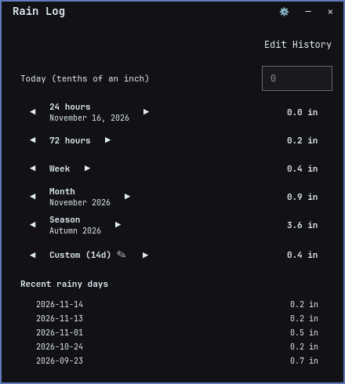
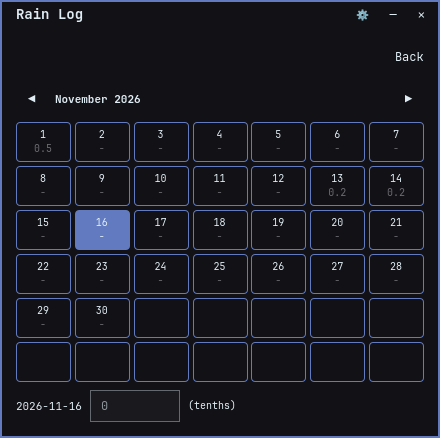
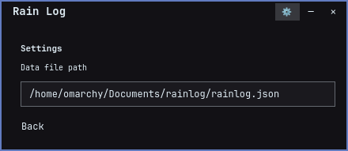

# Rain Log Desktop

A small, windowed companion to the
[Rain Log plugin](https://github.com/captain-reginald/omarchy-rain-log) for
Omarchy. It is the same card the bar widget opens — same layout, same controls,
same rainfall file — packaged as a normal application so it also works on
desktops that are not Hyprland, and on Windows.

| Main | History | Settings |
| --- | --- | --- |
|  |  |  |

## What it does

- Enter today's rainfall in tenths of an inch.
- See rolling totals for 24 hours, 72 hours, the week, the month, the current
  meteorological season, and a custom number of days.
- Scroll each total back through earlier windows without losing today's value.
- Review the last five rainy days at a glance.
- Edit any earlier day from a month calendar.
- Follow the current Omarchy theme (colors, typography, spacing, corner
  radius). On non-Omarchy systems it falls back to the bundled palette.

The window is frameless and sized like the plugin card. A slim title strip carries
the app name, the settings gear, and minimize/close; the rest of the strip can be
dragged. Closing saves and quits — there is no tray icon and no background process.

## Data

Both clients read and write the same JSON file:

```text
~/Documents/rainlog/rainlog.json
```

```json
{
  "entries": {
    "2026-11-14": 2,
    "2026-11-15": 5
  }
}
```

Values are **tenths of an inch**, keyed by local date. The file and its folder
are watched, so an edit made in the plugin (or by a sync client) shows up in
the desktop app while it is open. Writes are atomic and keep the plugin's
two-space JSON formatting; an untouched file is never rewritten.

On first run the app adopts the `dataPath` configured for the plugin in
`~/.config/omarchy/shell.json`, so there is no migration step. On Windows the
default resolves through the system Documents folder, which respects OneDrive
redirection.

App settings (window geometry, custom range) live separately in
`~/.config/rainlog/config.json` on Linux and `%APPDATA%\rainlog\config.json`
on Windows. They are deliberately kept out of the rainfall folder.

## Build (Linux)

Requires CMake 3.21+ and Qt 6.5+ (Core, Gui, Quick). On Arch:

```bash
sudo pacman -S cmake qt6-base qt6-declarative
```

Then:

```bash
cmake -S . -B build -DCMAKE_BUILD_TYPE=Release
cmake --build build
./build/rainlog
```

Install system-wide (binary, desktop entry, icon, license):

```bash
sudo cmake --install build --prefix /usr/local
```

Or install into your home directory:

```bash
cmake --install build --prefix ~/.local
```

### Hyprland

Hyprland tiles ordinary windows, so add a rule to keep Rain Log floating. In
Omarchy 4's Lua config (`~/.config/hypr/hyprland.lua`):

```lua
hl.window_rule({ name = "rainlog", match = { class = "rainlog" }, float = true })
```

For the legacy `.conf` parser:

```ini
windowrulev2 = float,class:^(rainlog)$
```

## Build (Windows 10 x64)

Requires Qt 6.5+ for MSVC (tested against the current Qt 6), CMake, and Visual
Studio 2022. From a Developer PowerShell:

```powershell
cmake -S . -B build -G "Visual Studio 17 2022" -A x64 `
  -DCMAKE_PREFIX_PATH=C:\Qt\6.12.0\msvc2022_64
cmake --build build --config Release
.\build\Release\rainlog.exe
```

For a distributable folder, run `windeployqt` against the built executable.
Windows packaging (bundled font, installer) is still in progress.

## Development

Render a page without a window manager, for documentation or visual checks:

```bash
QT_QPA_PLATFORM=offscreen ./build/rainlog --screenshot docs/screenshot-main.png
QT_QPA_PLATFORM=offscreen ./build/rainlog --view settings --screenshot docs/screenshot-settings.png
QT_QPA_PLATFORM=offscreen ./build/rainlog --view history --screenshot docs/screenshot-history.png
```

The shared layer lives in `shared/ui` (card UI, controls, theme parser) and
`shared/model/Model.js` (rainfall math). `qml/Main.qml` is the desktop host:
frameless window, window buttons, resize edges, geometry persistence, and the
single-instance IPC handshake.

## License

GPL-3.0-or-later. See [LICENSE](LICENSE).
